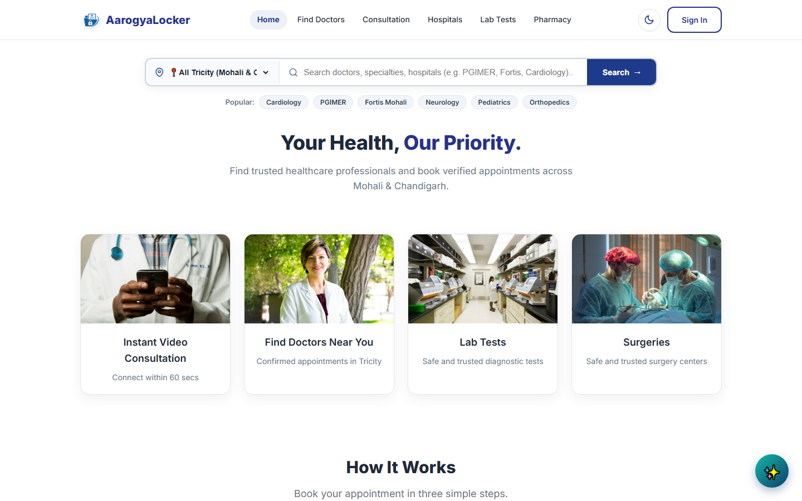
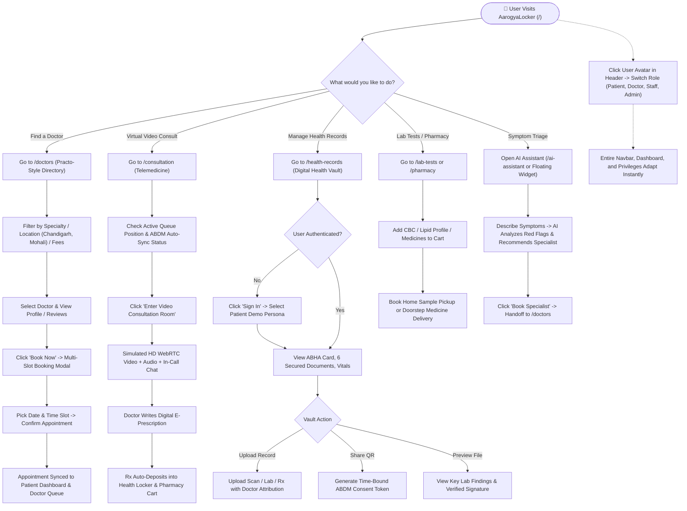
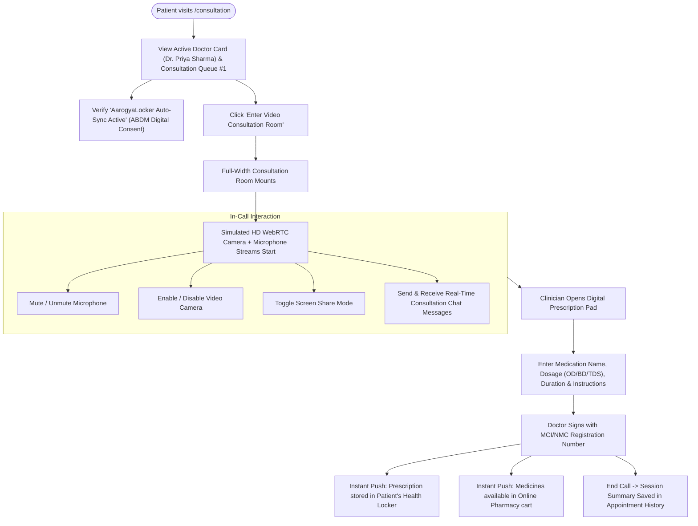
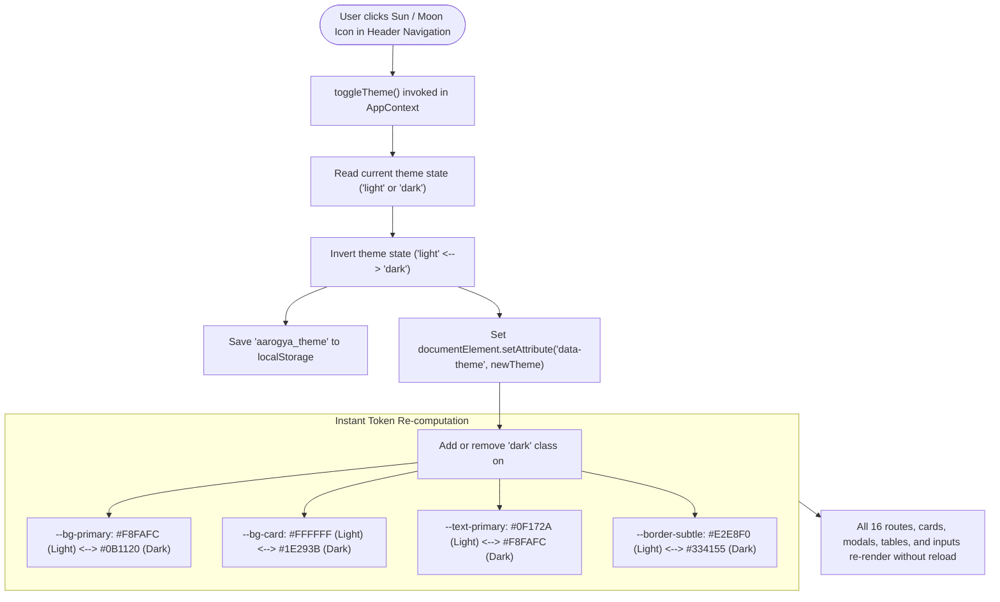
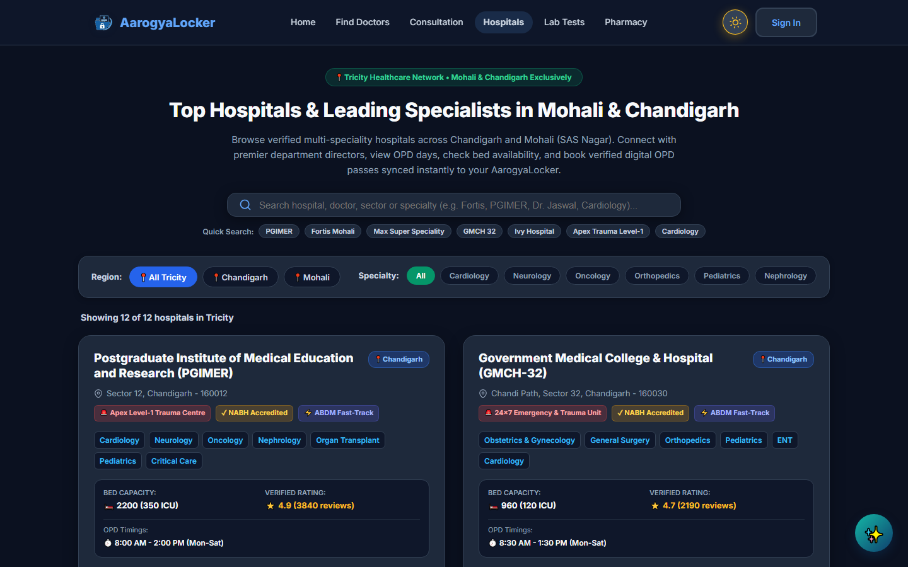

# AarogyaLocker 🏥🔐
### *Next-Generation ABHA Digital Health Locker & Unified Healthcare Ecosystem*

<div align="center">

[](https://react.dev/)
[](https://www.typescriptlang.org/)
[](https://vitejs.dev/)
[](https://reactrouter.com/)
[](https://abdm.gov.in/)
[](https://meity.gov.in/)
[](https://www.w3.org/WAI/standards-guidelines/wcag/)

</div>

---

<p align="center">
  
</p>

---

## 📖 Table of Contents
- [📌 Executive Overview](#-executive-overview)
- [🔄 How the Website Works (Step-by-Step Flowcharts)](#-how-the-website-works-step-by-step-flowcharts)
  - [Flowchart 1: Complete Website Navigation & User Journey](#flowchart-1-complete-website-navigation--user-journey)
  - [Flowchart 2: Doctor Discovery & Slot Booking Flow](#flowchart-2-doctor-discovery--slot-booking-flow)
  - [Flowchart 3: ABHA Digital Health Locker & Document Vault Flow](#flowchart-3-abha-digital-health-locker--document-vault-flow)
  - [Flowchart 4: Virtual Consultation & E-Prescription Delivery Flow](#flowchart-4-virtual-consultation--e-prescription-delivery-flow)
  - [Flowchart 5: Multi-Persona Role Switcher Workflow](#flowchart-5-multi-persona-role-switcher-workflow)
  - [Flowchart 6: Reactive Dark & Light Theme Engine Flow](#flowchart-6-reactive-dark--light-theme-engine-flow)
- [📸 Real Website Showcases & Screenshots](#-real-website-showcases--screenshots)
  - [1. Homepage — Dark & Light Mode](#1-homepage--dark--light-mode)
  - [2. ABHA Digital Health Vault](#2-abha-digital-health-vault)
  - [3. Find Doctors & Specialists (Practo-Style Directory)](#3-find-doctors--specialists-practo-style-directory)
  - [4. Top Hospitals & OPD Network (Dark Mode)](#4-top-hospitals--opd-network-dark-mode)
  - [5. Online Teleconsultation Suite](#5-online-teleconsultation-suite)
  - [6. Patient Health Dashboard & Telemetry](#6-patient-health-dashboard--telemetry)
  - [7. AI Health Specialist Triage](#7-ai-health-specialist-triage)
- [🚀 Core Modules & Features](#-core-modules--features)
  - [1. 🔐 ABHA Digital Health Locker](#1--abha-digital-health-locker)
  - [2. 📹 Virtual Teleconsultation & Live Room](#2--virtual-teleconsultation--live-room)
  - [3. 🩺 Practo-Grade Doctor Search & Scheduling](#3--practo-grade-doctor-search--scheduling)
  - [4. 🌓 Reactive Dark & Light Theme Engine](#4--reactive-dark--light-theme-engine)
  - [5. 🤖 AI Health Specialist & Global Widget](#5--ai-health-specialist--global-widget)
  - [6. ⚖️ Legal, Regulatory & Compliance Suite](#6-️-legal-regulatory--compliance-suite)
  - [7. 👥 Multi-Persona Management Portals](#7--multi-persona-management-portals)
- [🗺️ Complete Application Sitemap & Routes](#️-complete-application-sitemap--routes)
- [🎨 UI/UX Design System & Tokens](#-uiux-design-system--tokens)
- [💻 Tech Stack & Dependencies](#-tech-stack--dependencies)
- [⚡ Quickstart & Local Installation](#-quickstart--local-installation)
- [🔒 Regulatory Compliance & Disclaimer](#-regulatory-compliance--disclaimer)
- [🏆 CU Hackathon Attribution](#-cu-hackathon-attribution)

---

## 📌 Executive Overview

Healthcare data in India is traditionally fragmented across paper prescriptions, physical diagnostic films, hospital OPD receipts, and separate consultation platforms.

**AarogyaLocker** unifies the healthcare journey for Indian citizens. Designed specifically for the **CU Hackathon**, it combines:
1. **ABHA Digital Health Locker**: A secure, ABDM-compliant vault for lifelong health records (Lab Reports, Scans, Prescriptions, Vaccines).
2. **Practo-Grade Doctor Discovery**: Real-time search across verified doctors in the Tricity (Chandigarh, Mohali, Panchkula) with slot booking.
3. **Encrypted Teleconsultations**: HD virtual consultation room with live video, patient vital telemetry, in-call messaging, and instant e-prescriptions.
4. **Doorstep Diagnostics & Pharmacy**: Home sample collection lab tests and digital prescription fulfillment.
5. **AI Health Specialist**: 24/7 symptom triage assistant with continuous longitudinal health record context.
6. **Multi-Stakeholder Portals**: Seamless persona switcher for Patients, Clinicians, Hospital Desk Staff, and System Administrators.

---

## 🔄 How the Website Works (Step-by-Step Flowcharts)

### Flowchart 1: Complete Website Navigation & User Journey

This diagram illustrates how a user enters the AarogyaLocker platform and navigates through all primary modules:



---

### Flowchart 2: Doctor Discovery & Slot Booking Flow

How patients discover certified healthcare practitioners, filter by location and clinical specialty, and book time slots:


---

### Flowchart 3: ABHA Digital Health Locker & Document Vault Flow

How personal health records are stored, organized, and shared under ABDM guidelines:


---

### Flowchart 4: Virtual Consultation & E-Prescription Delivery Flow

The live telehealth consultation cycle from virtual queue to instant electronic prescription:



---

### Flowchart 5: Multi-Persona Role Switcher Workflow

How users can seamlessly test and explore all four stakeholder perspectives:


---

### Flowchart 6: Reactive Dark & Light Theme Engine Flow

How the theme switcher toggles color palettes with zero flicker and full persistence:



---

## 📸 Real Website Showcases & Screenshots

All screenshots below are captured directly from the live running **AarogyaLocker** application:

### 1. Homepage — Dark & Light Mode

*The homepage features a hero search bar with location selection for the Tricity network, quick service category cards, dynamic dark/light mode toggle in the navigation header, and the floating AI Assistant.*

<div align="center">

**🌙 Dark Mode:**
<p align="center">
  
</p>

**☀️ Light Mode:**
<p align="center">
  
</p>

</div>

---

### 2. ABHA Digital Health Vault

*The patient's digital locker displaying their verified Ayushman Bharat Health Account (ABHA ID), categorized health records (Lab Reports, Scans, Prescriptions, Vaccines), detailed lab findings, and document upload triggers.*

<p align="center">
  
</p>

---

### 3. Find Doctors & Specialists (Practo-Style Directory)

*Search and filter top clinicians across PGIMER, Fortis Mohali, Max Hospital, and GMCH 32. Each doctor card displays verified qualifications, experience, review ratings, consultation fees, and instant booking slots.*

<p align="center">
  
</p>

---

### 4. Top Hospitals & OPD Network (Dark Mode)

*Search and book verified OPD passes across Chandigarh & Mohali hospitals (PGIMER, GMCH-32, Fortis Mohali). Displays bed capacities, emergency trauma levels, NABH accreditation, and clinician rosters with full Dark & Light mode theme adaptation.*

<p align="center">
  
</p>

---

### 5. Online Teleconsultation Suite

*Distraction-free, full-width telehealth consultation room. Shows the virtual waiting queue position, ABDM auto-sync verification notice, clinician profile, and direct button to enter the HD WebRTC consultation room.*

<p align="center">
  
</p>

---

### 6. Patient Health Dashboard & Telemetry

*Patient dashboard showing real-time vital telemetry cards (Blood Pressure 120/80, Heart Rate 72 bpm, SpO2 98%, Fasting Glucose 95 mg/dL), active medications with dosage schedules, and upcoming appointment countdowns.*

<p align="center">
  
</p>

---

### 7. AI Health Specialist Triage

*Interactive AI Family Doctor conversational triage room with quick symptom chips, red flag evaluation, specialist routing, and 1-click booking handoff.*

<p align="center">
  
</p>

---

## 🚀 Core Modules & Features

### 1. 🔐 ABHA Digital Health Locker (`/health-records`)
- **Centralized Lifelong Medical Vault**: Store, filter, and preview clinical records across 4 structured categories:
  - 🔬 **Laboratory Diagnostic Reports** (Blood Panels, Lipid Profiles, HbA1c)
  - 🩻 **Radiological Scans & Imaging** (X-Rays, MRIs, CT Scans)
  - 💊 **Doctor Prescriptions** (Digital Rx with dosage instructions & QR codes)
  - 📄 **Hospital Discharge Summaries** & Post-Operative Notes
- **Interactive Record Upload Simulator**: Upload medical documents with doctor attribution, diagnosis tags, hospital name, and date indexing.
- **ABHA Card Simulation**: 14-digit Ayushman Bharat Health Account (ABHA) ID with QR code verification and Aadhaar linkage indicators.
- **Granular Consent Management**: Patient-controlled access gates permitting temporary, time-bound view tokens for consulting doctors.

### 2. 📹 Virtual Teleconsultation & Live Room (`/consultation`)
- **Virtual Waiting Room**: Queue position status ("You are 1st in the queue") with estimated wait times and clinician status badges.
- **Interactive Call Controls**: Simulated WebRTC HD video interface with microphone mute/unmute, camera toggle, screen sharing, and call termination.
- **Real-Time In-Call Messaging**: Live textual chat stream between doctor and patient during the appointment.
- **Instant E-Prescription Generator**: Clinician writes Rx notes, prescribed drugs, dosage frequencies, and duration, which instantly auto-deposits into the patient's Health Locker.
- **Consultation Ledger**: Historical log of upcoming, completed, and cancelled teleconsultation sessions.

### 3. 🩺 Practo-Grade Doctor Search & Scheduling (`/doctors`)
- **Real-Time Live Search & Multi-Filters**: Instant filtering by doctor name, medical specialty (Cardiologist, Neurologist, Dermatologist, Orthopedist, General Physician), experience, and consultation fees.
- **Transparent Clinician Profiles**: Verified medical council registration (MCI/NMC), clinic locations across Tricity, patient review scores, and spoken languages.
- **Interactive Booking Dialog (`BookingModal.tsx`)**: Slot-based appointment scheduler across 5 upcoming dates with dedicated morning and afternoon time slots.
- **Clinician Credential Modal (`ProfileModal.tsx`)**: In-depth doctor biography, career milestones, awards, and patient testimonials.

### 4. 🌓 Reactive Dark & Light Theme Engine
- **Universal Tokenization**: Built on unified CSS custom properties (`--bg-primary`, `--bg-card`, `--text-primary`, `--border-subtle`, `--accent-primary`).
- **Instant Adaptive Contrast**:
  - Light Mode: Crisp medical ice-blue backdrop, high-contrast dark slate typography, and clean elevation shadows.
  - Dark Mode: Premium deep slate surfaces (`#0f172a` & `#1e293b`), soft luminous borders, and eye-friendly text hierarchies.
- **Accessible Navbar Toggle**: Accessible via header on desktop, mobile drawer, and synchronized across browser sessions.

### 5. 🤖 AI Health Specialist & Global Widget (`/ai-assistant`)
- **AarogyaAI Doctor (v5.0)**: Conversational health triage providing preliminary symptom analysis, red-flag detection, precautionary home remedies, and specialist referrals.
- **Categorized Timeline History**: Organized chat history archives (Today, Previous Week, Monthly) for longitudinal symptom tracking.
- **Persistent Floating Widget (`AIFloatingWidget.tsx`)**: Accessible at the bottom-right corner of all routes for quick triage without navigating away.

### 6. ⚖️ Legal, Regulatory & Compliance Suite
- **Privacy Policy (`/privacy`)**: Rigorous data governance framework aligned with the **Digital Personal Data Protection Act 2023 (DPDP Act)**, detailing consent lifecycles, data fiduciary duties, purpose limitation, and patient right to erasure.
- **Terms of Service (`/terms`)**: Binding operational contract grounded in the **Telemedicine Practice Guidelines (2020)** under the National Medical Commission (NMC) Act, emergency red-line clauses, and clinician liability boundaries.
- **Accessibility Statement (`/accessibility`)**: Comprehensive conformance report adhering to **W3C WCAG 2.1 Level AA**, detailing screen reader compatibility, ARIA attributes, keyboard tab order, and color contrast ratios.
- **About Us (`/about`)**: Story, mission statement, institutional leadership, and regional integration with Tricity tertiary hospitals (PGIMER Chandigarh, GMCH Sector 32, Fortis Mohali, Max Super Speciality).

### 7. 👥 Multi-Persona Management Portals
- **Patient Dashboard (`/dashboard`)**: Personal health metrics, active medications, upcoming visits, emergency contacts, and vital telemetry graphs.
- **Doctor / Clinician Portal (`/doctor-dashboard`)**: Daily patient queue, consultation status markers (Waiting, In-Progress, Completed), appointment reschedulers, and electronic medical record access.
- **Hospital Reception & Triage Desk (`/staff-dashboard`)**: OPD counter workflow, patient record lookup by Universal Patient ID, and bed availability updates.
- **Platform Administration Center (`/admin`)**: System telemetry, provider credential verification pipeline, service uptime monitoring, and patient grievance resolution desk.

---

## 🗺️ Complete Application Sitemap & Routes

| # | Route | Module / View | Key Responsibilities |
| :-: | :--- | :--- | :--- |
| 1 | `/` | **Home Page** | Hero dual search bar, services grid, How It Works, Trust metrics, and reviews. |
| 2 | `/doctors` | **Find Doctors** | Practo-style doctor cards, specialty filters, profile modal, and booking dialog. |
| 3 | `/consultation` | **Online Consultation** | Full-width WebRTC room, waiting queue, live call controls, chat, and Rx generator. |
| 4 | `/health-records` | **ABHA Health Locker** | Categorized electronic records vault, document upload, ABHA ID card, and consent manager. |
| 5 | `/ai-assistant` | **AI Health Specialist** | Conversational triage assistant (v5.0), symptom assessment, and past chat archive. |
| 6 | `/dashboard` | **Patient Dashboard** | Personal health analytics, vitals telemetry, active prescriptions, and visit logs. |
| 7 | `/doctor-dashboard` | **Doctor Provider Portal** | Clinician schedule, waiting room queue, patient records review, and prescription pad. |
| 8 | `/staff-dashboard` | **Hospital Staff Desk** | Reception triage desk, patient document lookup by ID, and OPD queue tracker. |
| 9 | `/admin` | **Platform Administration** | Telehealth metrics, clinician credential verification, and grievance ticketing. |
| 10 | `/hospitals` | **Hospital Directory** | Searchable Tricity & national hospitals with ICU bed availability and departments. |
| 11 | `/lab-tests` | **Lab Tests & Diagnostics** | Diagnostic packages catalog, home sample collection booking, and checkout cart. |
| 12 | `/pharmacy` | **Online Pharmacy** | Medicine catalog, prescription verification upload banner, and order fulfillment. |
| 13 | `/privacy` | **Privacy Policy** | DPDP Act 2023 compliance, ABDM privacy directives, data retention, and patient rights. |
| 14 | `/terms` | **Terms of Service** | Telemedicine Practice Guidelines 2020, RMP protocols, and user terms. |
| 15 | `/accessibility` | **Accessibility Statement**| WCAG 2.1 AA conformance report, keyboard navigation, and screen reader features. |
| 16 | `/about` | **About Us** | Organizational mission, Tricity healthcare ecosystem, leadership, and vision. |

---

## 🎨 UI/UX Design System & Tokens

AarogyaLocker incorporates a bespoke, mathematically balanced color palette and typography system:

```css
:root {
  /* Core Healthcare Palette */
  --primary-navy: #0F3E6D;
  --secondary-teal: #14B8A6;
  --accent-emerald: #10B981;
  --danger-crimson: #EF4444;
  --warning-amber: #F59E0B;
  
  /* Adaptive Surfaces (Light Mode) */
  --bg-primary: #F8FAFC;
  --bg-card: #FFFFFF;
  --text-primary: #0F172A;
  --text-secondary: #64748B;
  --border-subtle: #E2E8F0;
}

[data-theme='dark'] {
  /* Adaptive Surfaces (Dark Mode) */
  --bg-primary: #0B1120;
  --bg-card: #1E293B;
  --text-primary: #F8FAFC;
  --text-secondary: #94A3B8;
  --border-subtle: #334155;
}
```

- **Zero-Dependency SVG Icons**: All icons (`AarogyaLockerLogo`, `SunIcon`, `MoonIcon`, `ShieldIcon`, `CalendarIcon`, `VideoIcon`, `UploadIcon`, etc.) are handcrafted inline SVGs to maintain a sub-100KB zero-bloat runtime.
- **Glassmorphic Elevations**: Subdued `backdrop-filter: blur(12px)` cards with dynamic border lighting.

---

## 💻 Tech Stack & Dependencies

| Layer | Technology | Purpose |
| :--- | :--- | :--- |
| **Framework** | [React 19.2.8](https://react.dev/) | Component architecture, Concurrent React features |
| **Language** | [TypeScript 5.x](https://www.typescriptlang.org/) | Strict static type safety across data models & props |
| **Routing** | [React Router v7](https://reactrouter.com/) | Client-side routing, route loaders, dynamic params |
| **Build Tool** | [Vite 8.3](https://vitejs.dev/) | Lightning-fast HMR and optimized production bundles |
| **Linter** | [Oxlint](https://oxc.rs/) | Rust-powered high-speed static code quality checker |
| **Styling** | Vanilla CSS3 Custom Properties | Scalable zero-runtime styling with native tokens |

---

## ⚡ Quickstart & Local Installation

### Prerequisites
- **Node.js** (v18.0.0 or higher recommended)
- **npm** (v9.0.0 or higher)

### Setup Steps

1. **Clone the repository:**
   ```bash
   git clone https://github.com/JD-codestar/AarogyaLocker.git
   cd AarogyaLocker
   ```

2. **Install dependencies:**
   ```bash
   npm install
   ```

3. **Start the local development server:**
   ```bash
   npm run dev
   ```

4. **Access the application:**
   Open [http://localhost:5173](http://localhost:5173) in any modern browser.

### Build & Code Quality Scripts
- `npm run dev` — Launches Vite local dev server with Hot Module Replacement.
- `npm run build` — Runs TypeScript compile check (`tsc -b`) and generates production build in `/dist`.
- `npm run lint` — Executes Oxlint for high-speed static linting.
- `npm run preview` — Spawns local preview server for the compiled distribution bundle.

---

## 🔒 Regulatory Compliance & Disclaimer

- **Digital Personal Data Protection (DPDP) Act 2023**: All mock patient records and health lockers operate under explicit consent primitives, data minimization standards, and local processing architectures.
- **Telemedicine Practice Guidelines (2020)**: Teleconsultation protocols comply with National Medical Commission guidelines regarding patient identification, digital prescription formats, and professional boundaries.
- **Academic & Hackathon Disclaimer**: *All doctor names, patient files, hospital rosters, and diagnostic results depicted within this prototype are synthetic datasets created for demonstration purposes during the CU Hackathon. The AI assistant is a supportive informational triage aid and does not constitute a substitute for professional clinical medical advice or diagnosis.*

---

## 🏆 CU Hackathon Attribution

Crafted with dedication by **JD-codestar** for the **CU Hackathon**.
Empowering citizens with sovereign, seamless, and secure digital healthcare.
