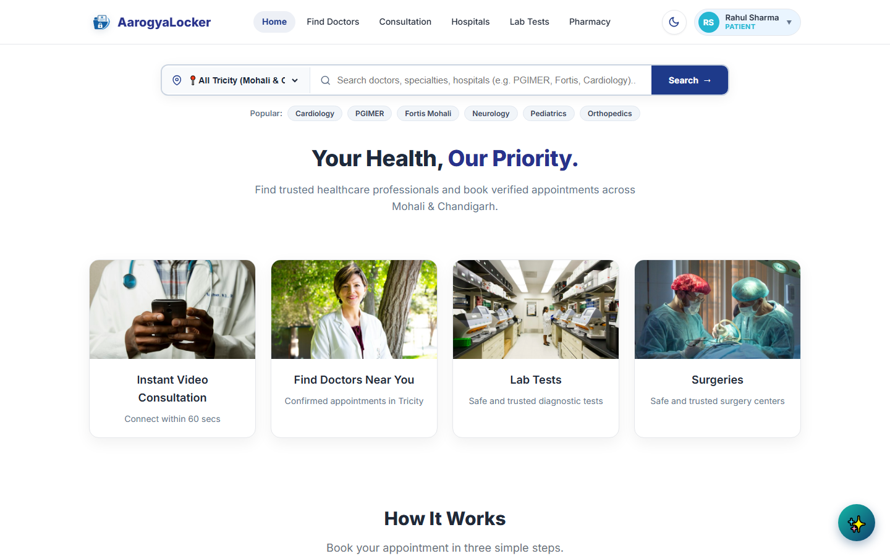
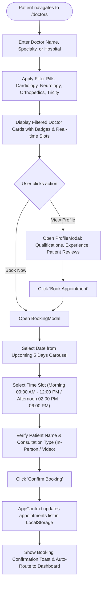
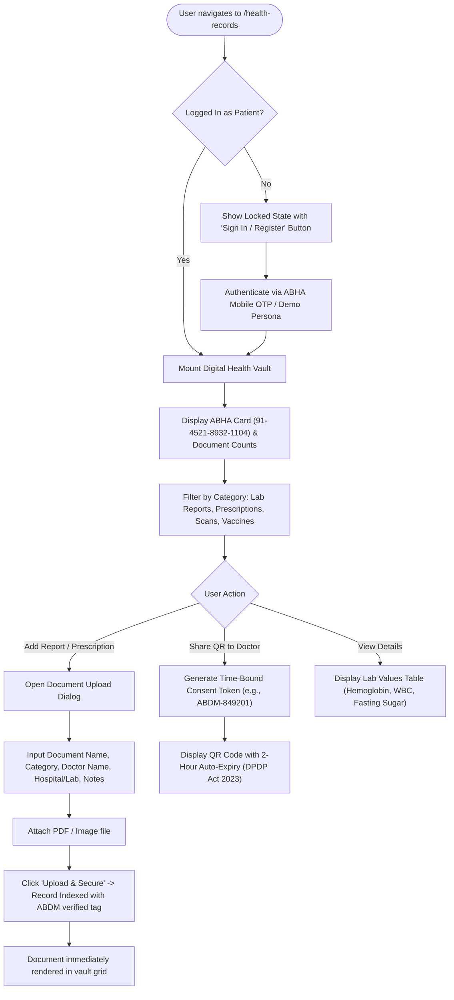
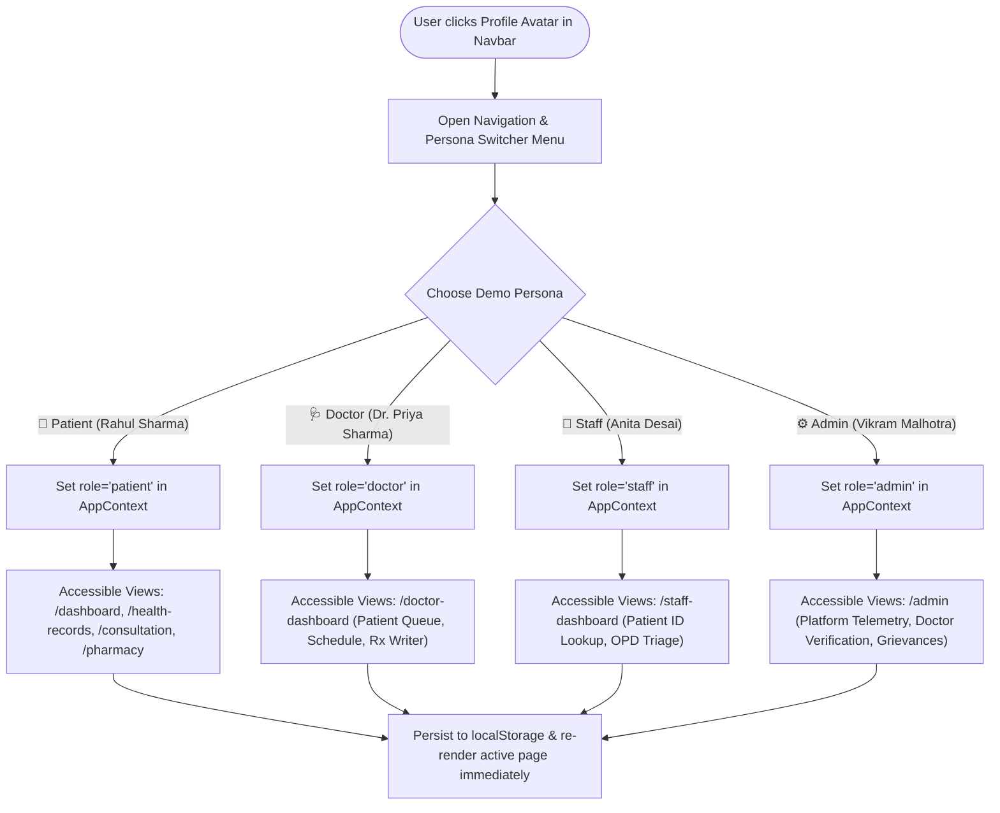
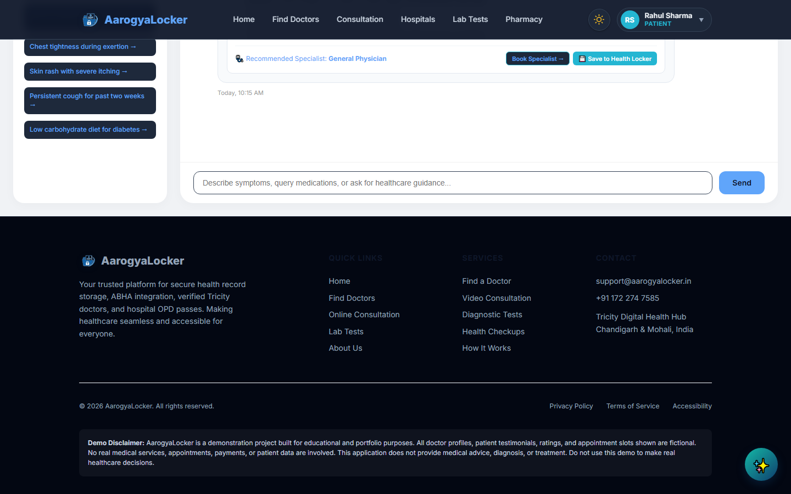
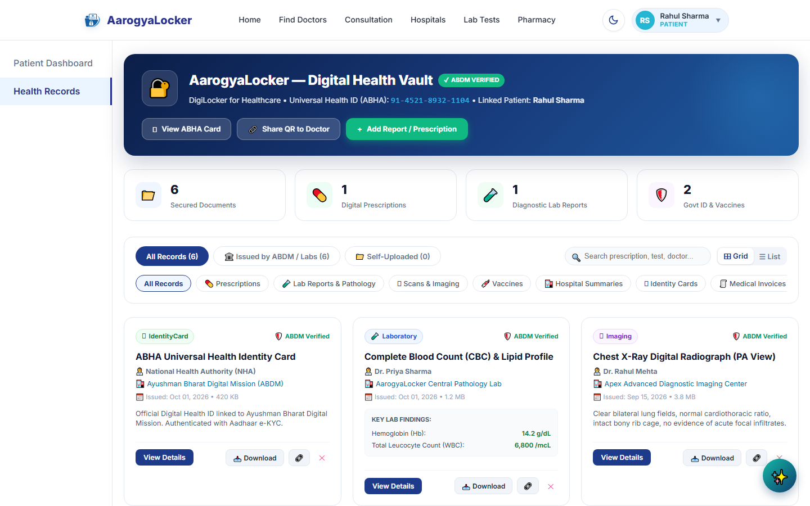
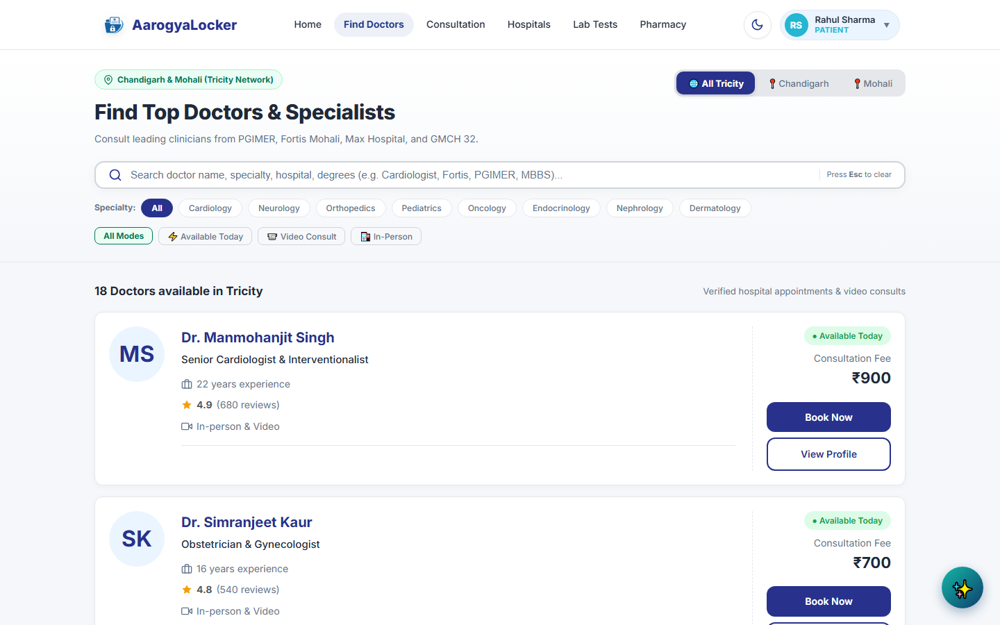
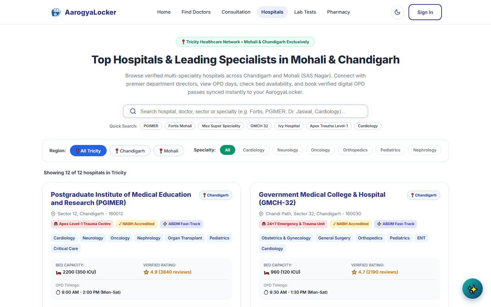
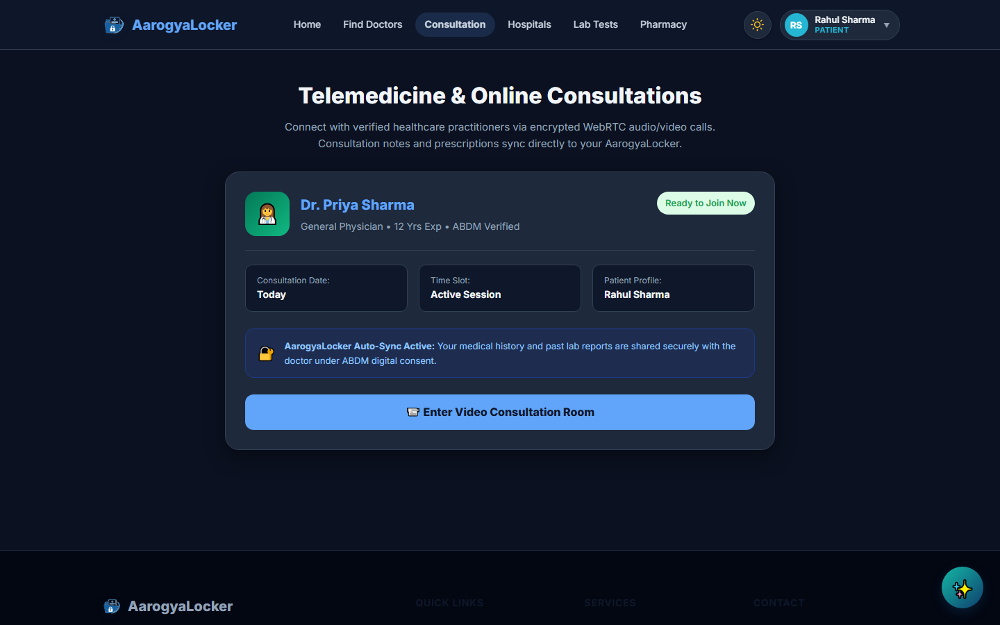
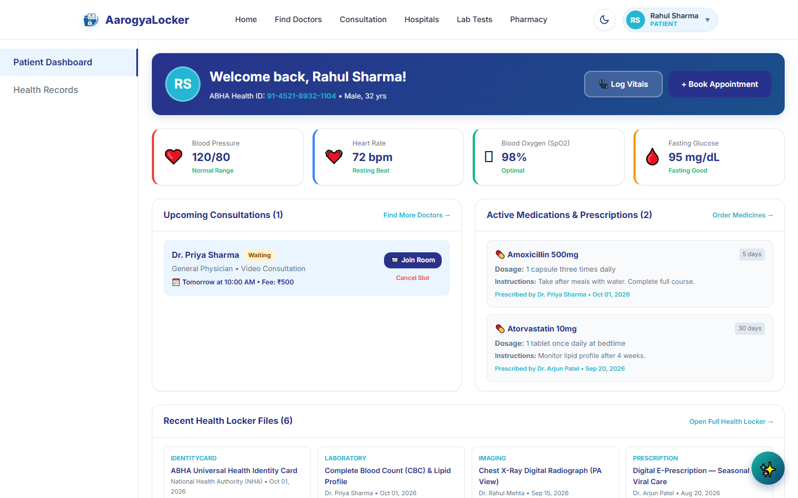

# AarogyaLocker 🏥🔐
### *Next-Generation ABHA Digital Health Locker & Unified Healthcare Ecosystem*

<div align="center">

[](https://react.dev/)
[](https://www.typescriptlang.org/)
[](https://vitejs.dev/)
[](https://reactrouter.com/)
[](https://abdm.gov.in/)
[](https://meity.gov.in/)
[](https://www.w3.org/WAI/standards-guidelines/wcag/)

</div>

---

<p align="center">
  
</p>

---

## 📖 Table of Contents
- [📌 Executive Overview](#-executive-overview)
- [🔄 System Architecture & Flowcharts](#-system-architecture--flowcharts)
  - [Flowchart 1: Complete User Journey & Routing](#flowchart-1-complete-user-journey--routing)
  - [Flowchart 2: Doctor Discovery & Appointment Booking](#flowchart-2-doctor-discovery--appointment-booking)
  - [Flowchart 3: ABHA Digital Health Locker & Consent Sharing](#flowchart-3-abha-digital-health-locker--consent-sharing)
  - [Flowchart 4: HD Teleconsultation & E-Prescription Generation](#flowchart-4-hd-teleconsultation--e-prescription-generation)
  - [Flowchart 5: Multi-Persona Role Switcher Engine](#flowchart-5-multi-persona-role-switcher-engine)
- [📸 Real Website Showcases & Screenshots](#-real-website-showcases--screenshots)
  - [1. Homepage & Smart Search Autocomplete](#1--homepage--smart-search-autocomplete)
  - [2. AI Health Specialist & Clinical Triage](#2--ai-health-specialist--clinical-triage)
  - [3. ABHA Digital Health Locker Vault](#3--abha-digital-health-locker-vault)
  - [4. Doctor Discovery Directory (Practo-Style)](#4--doctor-discovery-directory-practo-style)
  - [5. Hospital & OPD Pass Network (Tricity Coverage)](#5--hospital--opd-pass-network-tricity-coverage)
  - [6. Telehealth Video Consultation Room](#6--telehealth-video-consultation-room)
  - [7. Patient Health Dashboard & Telemetry](#7--patient-health-dashboard--telemetry)
- [🚀 Key Modules & Feature Highlights](#-key-modules--feature-highlights)
  - [1. 🔐 ABHA Digital Health Vault](#1--abha-digital-health-vault)
  - [2. 🤖 AI Health Specialist (v5.0 with Gemini API & Smart Autocomplete)](#2--ai-health-specialist-v50-with-gemini-api--smart-autocomplete)
  - [3. 🩺 Practo-Grade Doctor Discovery & Scheduling](#3--practo-grade-doctor-discovery--scheduling)
  - [4. 🏥 Hospital Directory & Digital OPD Passes](#4--hospital-directory--digital-opd-passes)
  - [5. 📹 Virtual Teleconsultation Room & Live Rx Push](#5--virtual-teleconsultation-room--live-rx-push)
  - [6. 🧪 Diagnostics & 💊 Online Pharmacy](#6--diagnostics---online-pharmacy)
  - [7. 👥 4 Multi-Stakeholder Portals](#7--4-multi-stakeholder-portals)
- [🗺️ Complete Application Sitemap (All 16 Routes)](#️-complete-application-sitemap-all-16-routes)
- [🎨 UI/UX Design System & Tokens](#-uiux-design-system--tokens)
- [💻 Tech Stack & Dependencies](#-tech-stack--dependencies)
- [⚡ Quickstart & Local Installation](#-quickstart--local-installation)
- [🚀 Universal Deployment Guide (Vercel, Netlify, GitHub Pages)](#-universal-deployment-guide-vercel-netlify-github-pages)
- [🔒 Regulatory Compliance & Disclaimers](#-regulatory-compliance--disclaimers)
- [🏆 Attribution](#-attribution)

---

## 📌 Executive Overview

Healthcare in India is traditionally plagued by fragmented paper prescriptions, lost diagnostic films, tedious hospital registration queues, and disconnected consultation platforms.

**AarogyaLocker** unifies the end-to-end healthcare journey for Indian citizens into a single, high-performance web platform. Aligned with the **Ayushman Bharat Digital Mission (ABDM)**, it combines:

1. **🔐 Sovereign ABHA Digital Health Locker**: Encrypted, lifelong personal health records vault (Lab Reports, Scans, Prescriptions, Vaccines) with time-bound QR consent sharing (DPDP Act 2023 compliant).
2. **🤖 AI Health Specialist & Triage Engine (v5.0)**: Conversational triage assistant with structured urgency levels, recommended precautions, 1-click doctor handoffs, and optional live Google Gemini API integration.
3. **🩺 Practo-Grade Doctor Discovery**: Real-time search across verified doctors in the Tricity (Chandigarh, Mohali, Panchkula) with slot-based scheduling.
4. **🏥 Tricity Hospital Directory & OPD Passes**: Real-time bed availability, emergency trauma levels, and instant paperless OPD pass booking across premier centers (PGIMER, GMCH-32, GMSH-16, Fortis Mohali, Max Super Speciality, Ivy, Sohana, Shalby).
5. **📹 Encrypted Teleconsultation Suite**: HD virtual consultation room with live video, patient vital telemetry, in-call messaging, and instant digital e-prescriptions.
6. **👥 Multi-Persona Management Portals**: Instant switcher between Patient, Doctor, Hospital Reception Staff, and System Administrator.

---

## 🔄 System Architecture & Flowcharts

### Flowchart 1: Complete User Journey & Routing


---

### Flowchart 2: Doctor Discovery & Appointment Booking



---

### Flowchart 3: ABHA Digital Health Locker & Consent Sharing



---

### Flowchart 4: HD Teleconsultation & E-Prescription Generation


---

### Flowchart 5: Multi-Persona Role Switcher Engine



---

## 📸 Real Website Showcases & Screenshots

All screenshots below are captured directly from the live running **AarogyaLocker** application:

---

### 1. 🏠 Homepage & Smart Search Autocomplete

*Featuring the intelligent dual search bar with query recommendations, quick healthcare services, live Tricity stats, and the floating AI Assistant.*

<p align="center">
  
</p>

---

### 2. 🤖 AI Health Specialist & Clinical Triage

*Equipped with clinical urgency ratings (Critical, High, Moderate, Low), possible causes, precautions, 1-click doctor routing, and optional Google Gemini API support.*

<p align="center">
  
</p>

---

### 3. 🔐 ABHA Digital Health Locker Vault

*The patient's digital locker displaying their verified Ayushman Bharat Health Account (ABHA ID), categorized health records (Lab Reports, Scans, Prescriptions, Vaccines), detailed lab findings, and document upload triggers.*

<p align="center">
  
</p>

---

### 4. 🩺 Doctor Discovery Directory (Practo-Style)

*Search and filter top clinicians across PGIMER, Fortis Mohali, Max Hospital, and GMCH 32. Each doctor card displays verified qualifications, experience, review ratings, consultation fees, and instant booking slots.*

<p align="center">
  
</p>

---

### 5. 🏥 Hospital & OPD Pass Network (Tricity Coverage)

*Search and book verified OPD passes across Chandigarh & Mohali hospitals (PGIMER, GMCH-32, Fortis Mohali). Displays bed capacities, emergency trauma levels, NABH accreditation, and clinician rosters.*

<p align="center">
  
</p>

---

### 6. 📹 Telehealth Video Consultation Room

*Distraction-free, full-width telehealth consultation room. Shows the virtual waiting queue position, ABDM auto-sync verification notice, clinician profile, and direct button to enter the HD WebRTC consultation room.*

<p align="center">
  
</p>

---

### 7. 📊 Patient Health Dashboard & Telemetry

*Patient dashboard showing real-time vital telemetry cards (Blood Pressure 120/80, Heart Rate 72 bpm, SpO2 98%, Fasting Glucose 95 mg/dL), active medications with dosage schedules, and upcoming appointment countdowns.*

<p align="center">
  
</p>

---

## 🚀 Key Modules & Feature Highlights

### 1. 🔐 ABHA Digital Health Vault (`/health-records`)
- **Centralized Lifelong Medical Vault**: Store, filter, and preview clinical records across 4 structured categories:
  - 🔬 **Laboratory Diagnostic Reports** (Blood Panels, Lipid Profiles, HbA1c)
  - 🩻 **Radiological Scans & Imaging** (X-Rays, MRIs, CT Scans)
  - 💊 **Doctor Prescriptions** (Digital Rx with dosage instructions & QR codes)
  - 📄 **Hospital Discharge Summaries** & Post-Operative Notes
- **Interactive Record Upload Simulator**: Upload medical documents with doctor attribution, diagnosis tags, hospital name, and date indexing.
- **ABHA Card Simulation**: 14-digit Ayushman Bharat Health Account (ABHA) ID with QR code verification and Aadhaar linkage indicators.
- **Granular Consent Management**: Patient-controlled access gates permitting temporary, time-bound view tokens for consulting doctors.

---

### 2. 🤖 AI Health Specialist (v5.0 with Gemini API & Smart Autocomplete)
- **Clinical Urgency Assessment**: Analyzes reported symptoms and classifies urgency:
  - 🚨 **Critical Emergency**: Immediate 112/108 ambulance prompt & nearest trauma center routing.
  - ⚠️ **High Priority**: Severe symptoms needing consultation within 4-12 hours.
  - 🟡 **Moderate**: Routine triage with suggested home precautions and doctor visits.
  - 🟢 **Low / Informational**: Health guidance, wellness checks, and preventive care.
- **Intelligent Structured Diagnosis**: Generates potential causes, step-by-step precautions, recommended specialists, and 1-click links to doctors/hospitals/tests.
- **Live Google Gemini LLM**: Built-in modal to paste your Gemini API key for real-time generative clinical intelligence.
- **Hero Search Autocomplete**: Recommends top doctors, Tricity hospitals, diagnostic packages, and common symptom queries dynamically as you type.

---

### 3. 🩺 Practo-Grade Doctor Discovery & Scheduling (`/doctors`)
- **Real-Time Live Search & Multi-Filters**: Instant filtering by doctor name, medical specialty (Cardiology, Neurology, Dermatology, Orthopedics, Pediatrics, General Physician), experience, and consultation fees.
- **Transparent Clinician Profiles**: Verified medical council registration (MCI/NMC), clinic locations across Tricity, patient review scores, and spoken languages.
- **Interactive Booking Dialog (`BookingModal.tsx`)**: Slot-based appointment scheduler across 5 upcoming dates with dedicated morning and afternoon time slots.
- **Clinician Credential Modal (`ProfileModal.tsx`)**: In-depth doctor biography, career milestones, awards, and patient testimonials.

---

### 4. 🏥 Hospital Directory & Digital OPD Passes (`/hospitals`)
- **Premier Tricity Network Coverage**:
  - **PGIMER Chandigarh** (Sector 12) — Level 1 Apex Trauma Center, 1900+ Beds.
  - **Government Medical College & Hospital (GMCH-32)** — 1000+ Beds, High-Volume OPD.
  - **Government Multi-Specialty Hospital (GMSH-16)** — Civil Hospital, 24/7 Casualty.
  - **Fortis Hospital Mohali** (Sector 62) — JCI & NABH Accredited Cardiac & Oncology.
  - **Max Super Speciality Hospital Mohali** (Sector 56) — Advanced Robotic Surgery.
  - **Ivy Hospital Mohali** (Sector 71) — Multispeciality & Critical Care.
  - **Sri Guru Harkrishan Sahib (Sohana) Hospital** — Eyecare, Multispeciality & Super-Speciality.
  - **Shalby Multi-Specialty Hospital Mohali** — Joint Replacement & Orthopedics.
- **Instant OPD Pass Generation**: Generates paperless OPD registration slips with QR codes to bypass hospital registration counters.
- **Department & Bed Telemetry**: Live indicators of available ICU beds, general ward beds, and emergency contact numbers.

---

### 5. 📹 Virtual Teleconsultation Room & Live Rx Push (`/consultation`)
- **Virtual Waiting Room**: Queue position status ("You are 1st in the queue") with estimated wait times and clinician status badges.
- **Interactive Call Controls**: Simulated WebRTC HD video interface with microphone mute/unmute, camera toggle, screen sharing, and call termination.
- **Real-Time In-Call Messaging**: Live textual chat stream between doctor and patient during the appointment.
- **Instant E-Prescription Generator**: Clinician writes Rx notes, prescribed drugs, dosage frequencies, and duration, which instantly auto-deposits into the patient's Health Locker.

---

### 6. 🧪 Diagnostics & 💊 Online Pharmacy
- **Doorstep Diagnostics (`/lab-tests`)**: Comprehensive health checkup packages (Full Body Health Check, Cardiac Risk Profile, Diabetes Care, Complete Blood Count, Liver Function Test) with certified home sample collection.
- **Online Medicine Delivery (`/pharmacy`)**: Digital pharmacy catalog with automatic prescription validation and express doorstep delivery.

---

### 7. 👥 4 Multi-Stakeholder Portals
- **Patient Dashboard (`/dashboard`)**: Personal health metrics, active medications, upcoming visits, emergency contacts, and vital telemetry graphs.
- **Doctor / Clinician Portal (`/doctor-dashboard`)**: Daily patient queue, consultation status markers (Waiting, In-Progress, Completed), appointment reschedulers, and electronic medical record access.
- **Hospital Reception & Triage Desk (`/staff-dashboard`)**: OPD counter workflow, patient record lookup by Universal Patient ID, and bed availability updates.
- **Platform Administration Center (`/admin`)**: System telemetry, provider credential verification pipeline, service uptime monitoring, and patient grievance resolution desk.

---

## 🗺️ Complete Application Sitemap (All 16 Routes)

| # | Route | Module / View | Key Responsibilities |
| :-: | :--- | :--- | :--- |
| 1 | `/` | **Home Page** | Hero search with recommendation autocomplete, service categories, How It Works, and trust metrics. |
| 2 | `/doctors` | **Find Doctors** | Practo-style doctor cards, specialty filters, profile modal, and booking dialog. |
| 3 | `/hospitals` | **Hospital Directory** | Tricity tertiary hospitals, OPD pass booking, ICU bed counts, and trauma levels. |
| 4 | `/consultation` | **Online Consultation** | Full-width WebRTC room, waiting queue, live call controls, chat, and Rx generator. |
| 5 | `/health-records` | **ABHA Health Locker** | Categorized electronic records vault, document upload, ABHA ID card, and consent manager. |
| 6 | `/ai-assistant` | **AI Health Specialist** | Conversational triage assistant (v5.0), symptom assessment, and Gemini API setup. |
| 7 | `/dashboard` | **Patient Dashboard** | Personal health analytics, vitals telemetry, active prescriptions, and visit logs. |
| 8 | `/doctor-dashboard` | **Doctor Provider Portal** | Clinician schedule, waiting room queue, patient records review, and prescription pad. |
| 9 | `/staff-dashboard` | **Hospital Staff Desk** | Reception triage desk, patient document lookup by ID, and OPD queue tracker. |
| 10 | `/admin` | **Platform Administration** | Telehealth metrics, clinician credential verification, and grievance ticketing. |
| 11 | `/lab-tests` | **Lab Tests & Diagnostics** | Diagnostic packages catalog, home sample collection booking, and checkout cart. |
| 12 | `/pharmacy` | **Online Pharmacy** | Medicine catalog, prescription verification upload banner, and order fulfillment. |
| 13 | `/privacy` | **Privacy Policy** | DPDP Act 2023 compliance, ABDM privacy directives, data retention, and patient rights. |
| 14 | `/terms` | **Terms of Service** | Telemedicine Practice Guidelines 2020, RMP protocols, and user terms. |
| 15 | `/accessibility` | **Accessibility Statement**| WCAG 2.1 AA conformance report, keyboard navigation, and screen reader features. |
| 16 | `/about` | **About Us** | Organizational mission, Tricity healthcare ecosystem, leadership, and vision. |

---

## 🎨 UI/UX Design System & Tokens

AarogyaLocker uses a unified, mathematically tuned CSS variables system:

```css
:root {
  /* Core Brand Colors */
  --color-deep-blue: #0f3e6d;
  --color-bright-cyan: #2db6fa;
  --color-vibrant-emerald: #17d9a3;
  --color-ice-blue: #e8f7fd;

  /* Semantic UI Tokens */
  --color-white: #ffffff;
  --color-light-bg: #f8fafc;
  --color-dark-text: #0f172a;
  --color-slate: #475569;
  --color-gray-200: #e2e8f0;
}
```

- **Zero-Dependency SVG Icons**: Handcrafted inline SVGs (`AarogyaLockerLogo`, `ShieldIcon`, `CalendarIcon`, `VideoIcon`, `UploadIcon`, etc.) maintain a sub-100KB bundle footprint.
- **Micro-Animations & Responsive Transitions**: Subtle hover lifts, glowing status pills, and backdrop-blur overlays.

---

## 💻 Tech Stack & Dependencies

| Layer | Technology | Purpose |
| :--- | :--- | :--- |
| **Framework** | [React 19.2.8](https://react.dev/) | Component architecture, Concurrent React features |
| **Language** | [TypeScript 5.x](https://www.typescriptlang.org/) | Strict static type safety across data models & props |
| **Routing** | [React Router v7](https://reactrouter.com/) | Client-side routing, route loaders, dynamic params |
| **Build Tool** | [Vite 8.3](https://vitejs.dev/) | Fast HMR and production bundle optimization |
| **Linter** | [Oxlint](https://oxc.rs/) | Static code quality analyzer |
| **Styling** | Vanilla CSS3 Custom Properties | Zero-runtime styling with native CSS variables |
| **AI LLM API** | [Google Gemini API](https://ai.google.dev/) | Optional live generative triage intelligence |

---

## ⚡ Quickstart & Local Installation

### Prerequisites
- **Node.js** (v18.0.0 or higher recommended)
- **npm** (v9.0.0 or higher)

### Setup Steps

1. **Clone the repository:**
   ```bash
   git clone https://github.com/JD-codestar/AarogyaLocker.git
   cd AarogyaLocker
   ```

2. **Install dependencies:**
   ```bash
   npm install
   ```

3. **Start the local development server:**
   ```bash
   npm run dev
   ```

4. **Access the application:**
   Open [http://localhost:5173](http://localhost:5173) in any modern browser.

### Build & Verification Commands
- `npm run dev` — Launches Vite local dev server with Hot Module Replacement.
- `npm run build` — Runs TypeScript compile check (`tsc -b`) and generates production bundle in `/dist`.
- `npm run lint` — Executes Oxlint for high-speed static linting.
- `npm run preview` — Spawns local preview server for the compiled distribution bundle.

---

## 🚀 Universal Deployment Guide (Vercel, Netlify, GitHub Pages)

The repository includes pre-configured SPA routing files (`vercel.json` and `public/_redirects`) and dynamic `basename` handling in `src/main.tsx` to ensure direct page refreshes (e.g. `/ai-assistant` or `/doctors`) work out of the box without 404 errors.

### Option 1: Vercel (Recommended — 1-Click)
1. Go to [vercel.com](https://vercel.com/) and import the `JD-codestar/AarogyaLocker` repository.
2. Vercel auto-detects Vite:
   - **Framework:** `Vite`
   - **Build Command:** `npm run build`
   - **Output Directory:** `dist`
3. Click **Deploy**. The included [`vercel.json`](vercel.json) handles SPA rewrites automatically.

### Option 2: Netlify
1. Go to [netlify.com](https://www.netlify.com/) and connect your GitHub repository.
2. Set build command to `npm run build` and publish directory to `dist`.
3. Click **Deploy**. The included [`public/_redirects`](public/_redirects) routes all requests to `/index.html`.

### Option 3: Terminal CLI Deployment
```bash
# Deploy to Vercel production directly from terminal
npx vercel --prod
```

---

## 🔒 Regulatory Compliance & Disclaimers

- **Digital Personal Data Protection (DPDP) Act 2023**: All mock patient records and health lockers operate under explicit consent primitives, data minimization standards, and local processing architectures.
- **Telemedicine Practice Guidelines (2020)**: Teleconsultation protocols comply with National Medical Commission guidelines regarding patient identification, digital prescription formats, and professional boundaries.
- **Academic & Prototype Disclaimer**: *All doctor profiles, patient files, hospital rosters, and diagnostic results depicted within this prototype are synthetic datasets created for demonstration purposes during the CU Hackathon. The AI assistant is a supportive informational triage aid and does not constitute a substitute for professional clinical medical advice or diagnosis.*

---

## 🏆 Attribution

Crafted with dedication by **JD-codestar** for the **CU Hackathon**.  
Empowering citizens with sovereign, seamless, and secure digital healthcare across India.
